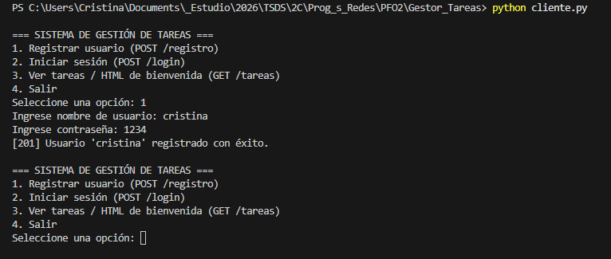
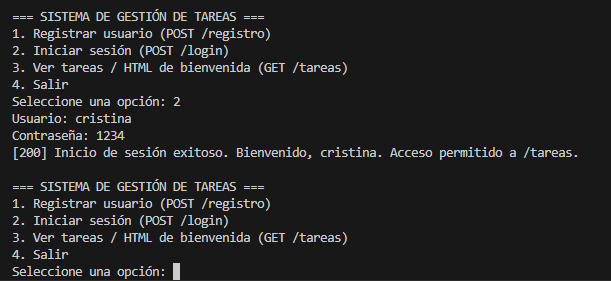
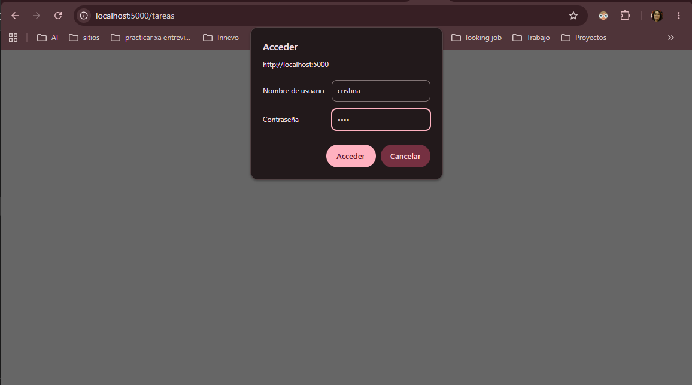
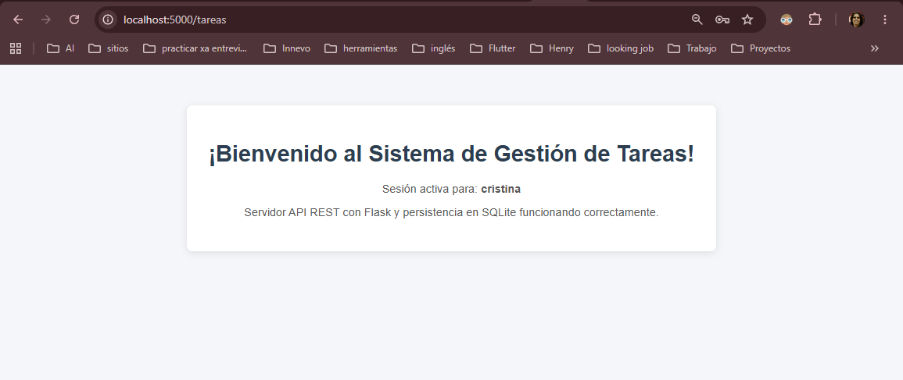
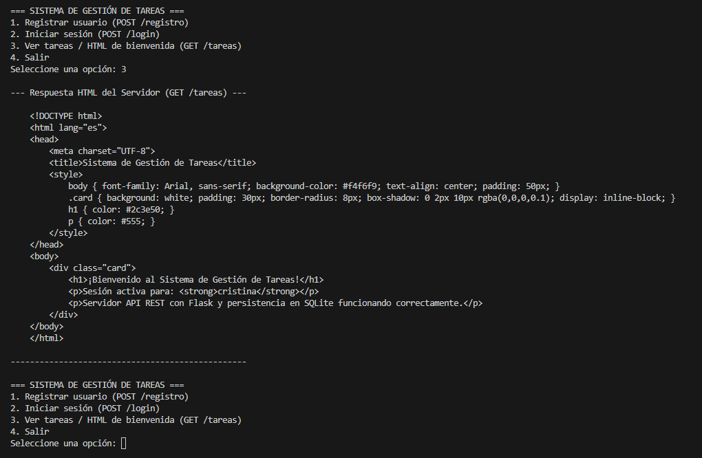

# Sistema de Gestión de Tareas — PFO 2

**Materia:** Programación sobre redes

**Año:** 3º E

**Alumna:** Cristina Laura Murguía Báez

**GitHub Pages:** [Gestor de Tareas](https://crismurbaez.github.io/Gestor-Tareas/)

---

## Instrucciones para ejecutar y probar el proyecto

### 1. Instalar dependencias

```powershell
.\venv\Scripts\Activate.ps1
pip install -r requirements.txt
```

### 2. Iniciar el servidor

En una terminal:

```powershell
python servidor.py
```

### 3. Iniciar el cliente

En otra terminal:

```powershell
python cliente.py
```

### 4. Probar el sistema

Seguir el menú interactivo en el orden:

1. **Opción 1** — Registrar un nuevo usuario (ej: usuario `cristina`, contraseña `1234`)
2. **Opción 2** — Iniciar sesión con esas mismas credenciales
3. **Opción 3** — Ver el HTML de bienvenida del servidor (requiere haber iniciado sesión)
4. **Opción 4** — Salir

---

## Capturas de pantalla de pruebas exitosas

### Captura 1 — Registro de usuario exitoso (POST /registro)

El cliente envía las credenciales al endpoint `/registro`. El servidor responde con código `201` y confirma que el usuario fue creado.



### Captura 2 — Inicio de sesión exitoso (POST /login)

El cliente envía las credenciales al endpoint `/login`. El servidor verifica el hash de la contraseña y responde con código `200`.



### Captura 3 — Autenticación Básica requerida al acceder a GET /tareas

El servidor responde con un desafío de autenticación (HTTP 401 + `WWW-Authenticate`) cuando se accede sin credenciales. El navegador muestra el diálogo de login automáticamente.



### Captura 4 — HTML de bienvenida renderizado (GET /tareas — acceso exitoso)

Tras ingresar las credenciales correctas, el servidor retorna el HTML de bienvenida que el navegador renderiza como página web.



### Captura 5 — Cliente en consola recibiendo la respuesta HTML (GET /tareas)

El cliente Python envía las credenciales mediante HTTP Basic Auth e imprime la respuesta HTML del servidor en la terminal.



---

## Respuestas Conceptuales

### ¿Por qué hashear contraseñas?

Hashear contraseñas es una práctica de seguridad fundamental. Si las contraseñas se almacenaran en texto plano, cualquier persona que accediera al archivo de base de datos (`tareas.db`) obtendría las contraseñas de todos los usuarios de forma directa.

Un hash es una función de **una sola vía**: convierte el texto original en una cadena irreversible. Aunque alguien robe la base de datos, no puede recuperar la contraseña original. En este proyecto se usa `generate_password_hash()` de Werkzeug para guardar y `check_password_hash()` para verificar, sin comparar contraseñas en texto plano en ningún momento.

### Ventajas de usar SQLite en este proyecto

- **Sin servidor adicional**: no requiere instalar ni configurar un servidor de base de datos separado. El motor se ejecuta dentro del mismo proceso Python.
- **Archivo único**: toda la base de datos se guarda en un solo archivo (`tareas.db`), lo que facilita la portabilidad y la entrega del proyecto.
- **Integrado en Python**: el módulo `sqlite3` viene incluido en la biblioteca estándar, sin dependencias extras.
- **Ideal para este contexto**: para un sistema con pocos usuarios, SQLite ofrece rendimiento suficiente con complejidad mínima.
