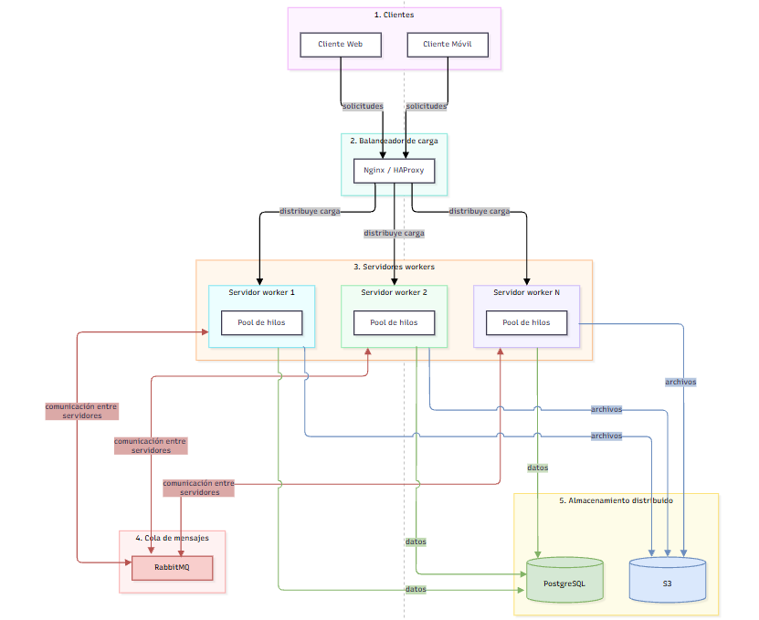

# Sistema de Gestión de Tareas distribuido — PFO 3

**Materia:** Programación sobre redes

**Año:** 3º E

**Alumna:** Cristina Laura Murguía Báez

**GitHub Pages:** [Gestor de Tareas Distribuido](https://crismurbaez.github.io/Gestor-tareas-distribuido/)

---

## Diagrama del sistema

Arquitectura distribuida cliente-servidor del Gestor de Tareas: los clientes envían solicitudes a
través de un balanceador de carga, que las reparte entre varios servidores workers. Cada servidor
worker mantiene su propio pool de hilos y se comunica con los demás mediante una cola de mensajes
(RabbitMQ). La persistencia se resuelve con almacenamiento distribuido (PostgreSQL + S3).
[Link del diagrama](https://drive.google.com/file/d/1I0CryYUOq5hb4gDlQqSg-l8gcf8jjcMA/view?usp=sharing)



### Componentes del diagrama

| # | Componente | Rol |
|---|---|---|
| 1 | **Clientes** | Aplicaciones web y móviles que envían solicitudes al sistema. |
| 2 | **Balanceador de carga** | Recibe todas las solicitudes y las reparte entre los servidores workers (Nginx / HAProxy). |
| 3 | **Servidores workers** | Procesan las solicitudes. Cada servidor tiene su propio pool de hilos para atender varias tareas en paralelo. |
| 4 | **Cola de mensajes (RabbitMQ)** | Canal de comunicación entre servidores: permite que los workers intercambien y distribuyan tareas entre sí. |
| 5 | **Almacenamiento distribuido** | PostgreSQL guarda los datos estructurados y S3 los archivos. Ambos son accesibles desde todos los servidores. |

> El diagrama representa la arquitectura distribuida objetivo de la consigna. El código de este
> repositorio implementa la consigna 2 en una versión de un solo proceso: el servidor recibe las
> tareas por socket y las distribuye a su pool de hilos mediante una `queue.Queue`, con SQLite como
> persistencia local.

---

## Arquitectura

Esta versión abandona Flask/HTTP y utiliza directamente la biblioteca nativa `socket` para la
transmisión de datos por red sobre TCP.

- **`servidor.py`**: un socket TCP principal acepta conexiones y las encola de inmediato en una
  `queue.Queue`. Un pool de 3 hilos *worker* consume esa cola concurrentemente, ejecuta la lógica de
  negocio contra SQLite y devuelve la respuesta codificada en JSON.
- **`cliente.py`**: abre un socket TCP por petición, envía un diccionario serializado en JSON y
  espera la respuesta JSON del servidor.

### Protocolo de mensajes

Cada mensaje viaja con un **prefijo de longitud de 4 bytes (big-endian)** seguido del cuerpo JSON
codificado en UTF-8. Esto evita que un `recv()` corte un mensaje a la mitad cuando el payload supera
el tamaño del buffer.

```
[ 4 bytes: longitud N ][ N bytes: JSON UTF-8 ]
```

### Acciones soportadas

| Acción       | Campos enviados                          | Respuesta                                  |
|--------------|------------------------------------------|--------------------------------------------|
| `registro`   | `usuario`, `password`                    | `status`, `mensaje`                        |
| `login`      | `usuario`, `password`                    | `status`, `mensaje`                        |
| `get_tareas` | `auth` (booleano)                        | `status`, `mensaje`, `tareas`              |

---

## Instrucciones para ejecutar y probar el proyecto

### 1. Instalar dependencias

```powershell
.\venv\Scripts\Activate.ps1
pip install -r requirements.txt
```

### 2. Iniciar el servidor

En una terminal:

```powershell
python servidor.py
```

El servidor crea la base `tareas_distribuido.db`, levanta el pool de workers y queda escuchando en
`localhost:5000`.

### 3. Iniciar el cliente

En otra terminal:

```powershell
python cliente.py
```

### 4. Probar el sistema

Seguir el menú interactivo en el orden:

1. **Opción 1** — Registrar un nuevo usuario (ej: usuario `cristina`, contraseña `1234`)
2. **Opción 2** — Iniciar sesión con esas mismas credenciales
3. **Opción 3** — Ver las tareas distribuidas (requiere haber iniciado sesión)
4. **Opción 4** — Salir

---

## Respuestas Conceptuales

### ¿Por qué hashear contraseñas?

Hashear contraseñas es una práctica de seguridad fundamental. Si las contraseñas se almacenaran en
texto plano, cualquier persona que accediera al archivo de base de datos (`tareas_distribuido.db`)
obtendría las contraseñas de todos los usuarios de forma directa.

Un hash es una función de **una sola vía**: convierte el texto original en una cadena irreversible.
Aunque alguien robe la base de datos, no puede recuperar la contraseña original. En este proyecto se
usa `generate_password_hash()` de Werkzeug para guardar y `check_password_hash()` para verificar, sin
comparar contraseñas en texto plano en ningún momento.

### Ventajas de usar SQLite en este proyecto

- **Sin servidor adicional**: no requiere instalar ni configurar un servidor de base de datos
  separado. El motor se ejecuta dentro del mismo proceso Python.
- **Archivo único**: toda la base de datos se guarda en un solo archivo
  (`tareas_distribuido.db`), lo que facilita la portabilidad y la entrega del proyecto.
- **Integrado en Python**: el módulo `sqlite3` viene incluido en la biblioteca estándar, sin
  dependencias extras.
- **Ideal para este contexto**: para un sistema con pocos usuarios, SQLite ofrece rendimiento
  suficiente con complejidad mínima.

### ¿Por qué usar `threading` + `queue` en el servidor?

El hilo principal queda dedicado exclusivamente a `accept()`: aceptar conexiones es una operación
rápida y no debe bloquearse con el procesamiento de cada petición. Al encolar la conexión, el trabajo
pesado (consultas a SQLite, hashing) se reparte entre varios workers que la consumen en paralelo. La
`queue.Queue` es segura para hilos (*thread-safe*), por lo que no hay condiciones de carrera al
repartir las conexiones, y `task_done()` permite saber cuándo se terminó de atender cada una.
